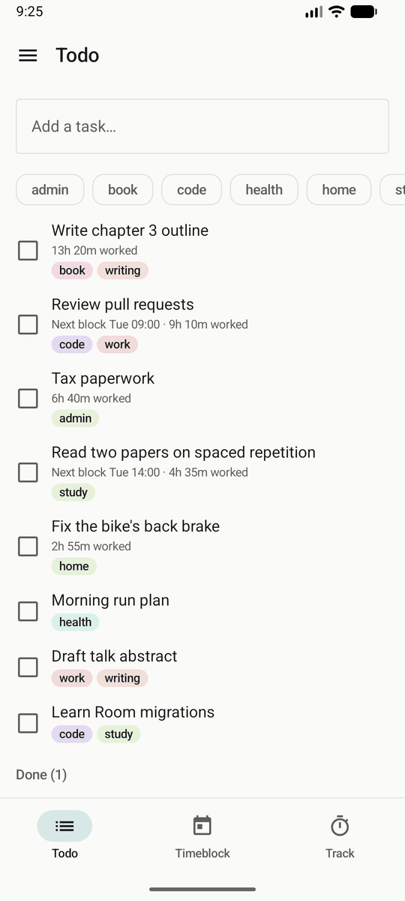
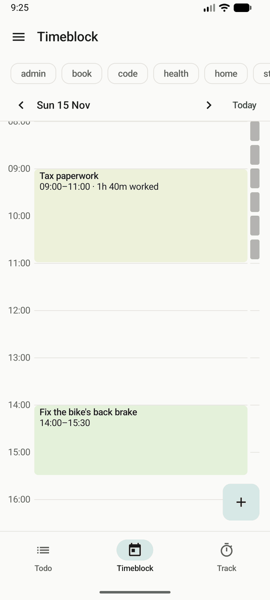
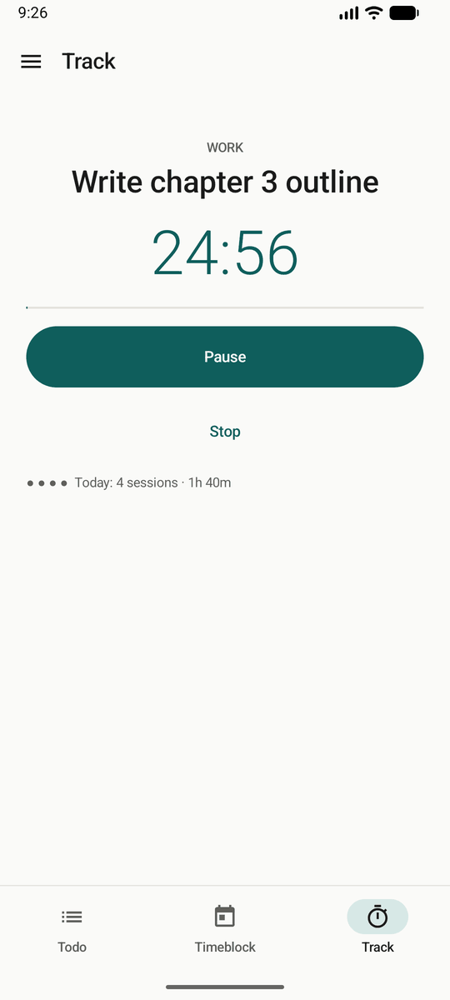
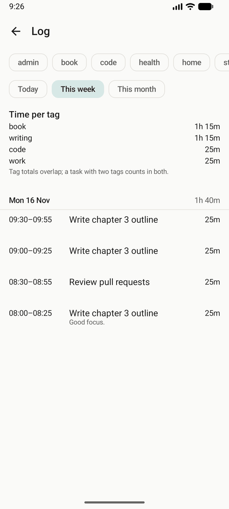
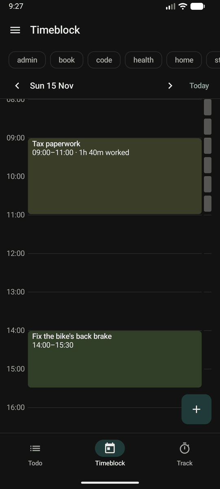

# ttt

Time blocking, time tracking and to-do, in one small Android app.

- **To-do**: what I want to do.
- **Timeblock**: when I will do it (time blocks on a day timeline).
- **Track**: a pomodoro timer that records when I actually did it, with notes.

Free and open source. No accounts, no ads, no analytics, no network access.

> Status: milestone **M8** (polish). Todo, Timeblock (planned vs actual time), Track (pomodoro), Log,
> Settings, backup / restore / auto-backup and the spreadsheet report work end to end.
> See `SPEC.md` section 18 for the build order.

## Screenshots

| Todo | Timeblock | Track | Log | Timeblock (dark) |
|---|---|---|---|---|
|  |  |  |  |  |

Made with the demo data from `tools/make_test_db.py --demo` (see `docs/CHANGING.md`).

## Build and install (Linux)

Requirements: Android Studio (or the Android SDK command-line tools) and a JDK 17 or newer.

```sh
cd ~/AndroidStudioProjects/ttt
./gradlew :core:test            # pure-Kotlin rules, no device needed
./gradlew :app:testDebugUnitTest
./gradlew :app:connectedDebugAndroidTest   # database tests, on a connected phone or emulator
./gradlew :app:assembleDebug    # APK in app/build/outputs/apk/debug/
./gradlew :app:installDebug     # install on a connected phone (USB debugging on)
```

## Release build

A release APK must be signed with your own **Android signing key**. This is not an SSH key: Android
needs a Java keystore file (`.jks`) holding a private key and a certificate. Make a new one just for
this app. Keep the `.jks` file and its passwords safe and backed up, outside the project folder:
**if the key is lost, the app can never be updated** (Android only accepts updates signed with the same key).

### With Android Studio (easiest)

1. **Build → Generate Signed App Bundle or APK…** → choose **APK** → **Next**.
2. Under *Key store path* click **Create new…** and fill in:
   - *Key store path*: for example `~/keys/ttt-release.jks` (outside the project folder).
   - *Password* and *Confirm* for the key store; choose them yourself.
   - *Key*: Alias `ttt`, its own password, *Validity* 25 years or more.
   - *Certificate*: at least *First and Last Name*; the rest may stay empty.
   Click **OK**.
3. Back in the wizard the new key is filled in; click **Next**, choose the **release** build variant, click **Create**.
4. The signed APK is in `app/release/app-release.apk` (git-ignored). Android Studio shows a "locate" link when it is done.

For the next release, open the same wizard and pick **Choose existing…** with the same `.jks` file and alias.
Never create a second key for ttt.

### From the command line (optional)

The command line build can use the same key. Create `keystore.properties` in the project root
(it is in `.gitignore`; never commit it):
```properties
storeFile=/home/you/keys/ttt-release.jks
storePassword=...
keyAlias=ttt
keyPassword=...
```
Then build and check the signature:
```sh
./gradlew :app:assembleRelease          # APK in app/build/outputs/apk/release/
~/Android/Sdk/build-tools/*/apksigner verify --print-certs app/build/outputs/apk/release/app-release.apk
```
Without `keystore.properties`, `assembleRelease` still works and makes `app-release-unsigned.apk`, which cannot be installed.
To make a key without Android Studio: `keytool -genkeypair -v -keystore ~/keys/ttt-release.jks -keyalg RSA -keysize 4096 -validity 10000 -alias ttt`.

### Before publishing

Install the signed APK on a phone and go through the checklist in `docs/CHANGING.md` before attaching it to a GitHub Release.

A release APK cannot be installed over a debug build (different keys): uninstall the debug build first, which deletes its data (make a backup first).

## Documentation

- `SPEC.md` — what the app does and does not do (the source of truth).
- `docs/ARCHITECTURE.md` — layers, folders, data flow.
- `docs/DATA.md` — database tables and the backup format.
- `docs/DEPENDENCIES.md` — every dependency and why.
- `docs/CHANGING.md` — recipes for common changes, and the manual test checklist.
- `docs/DECISIONS.md` — dated log of decisions.

## Licence

ttt is free software under the **GNU General Public License, version 3 or (at your option) any later
version** (SPDX: `GPL-3.0-or-later`). The full text is in [`LICENSE`](LICENSE).

Copyright (C) 2026 Ritobrata Ghosh
